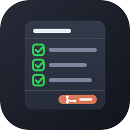
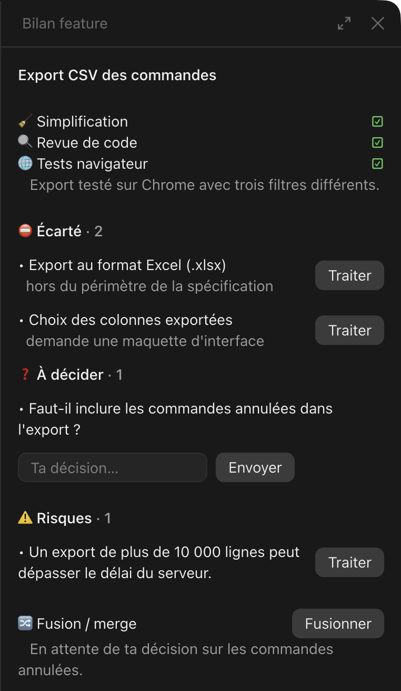

<p align="center"></p>

# feature-checklist : le bilan feature dans un panneau

Un mod Claude Code qui remplace le tableau de fin du cycle [`dev`](../dev) par un
panneau à côté de la conversation, d'où chaque point se traite.

<p align="center"></p>

## Ce que montre le panneau

- **Simplification, revue de code, tests navigateur, fusion** : faits ou non.
- **Écarté** et **Risques** : un bouton **Traiter** par élément, qui envoie la
  demande dans la conversation.
- **À décider** : un champ sous chaque question pour donner ta décision.
- **Fusionner**, tant que la fonctionnalité n'est pas fusionnée.

Fermé, le panneau se rouvre avec le bouton **📋 Bilan feature** au-dessus de la
saisie, ou avec `/bilan-feature`. Un `/clear` l'efface.

## Installation

```
/plugin install feature-checklist --marketplace enzomerand/palan-plugins
```

`dev` s'installe avec lui, puisque le mod en dépend. Sans le mod, `dev` termine
par un tableau dans la conversation.

Essayé avec Claude Code 2.1.317 dans l'application de bureau ; ses tests
couvrent aussi le terminal, VS Code et le mobile. Sur mobile, les décisions se
donnent dans la conversation.

## Développement

`claude plugin test plugins/feature-checklist` lance les tests, et
`claude plugin validate plugins/feature-checklist` vérifie le mod.
