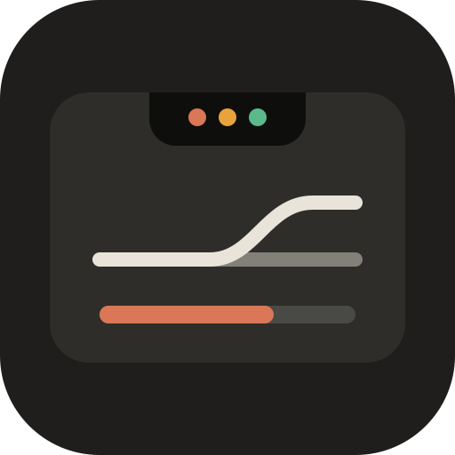
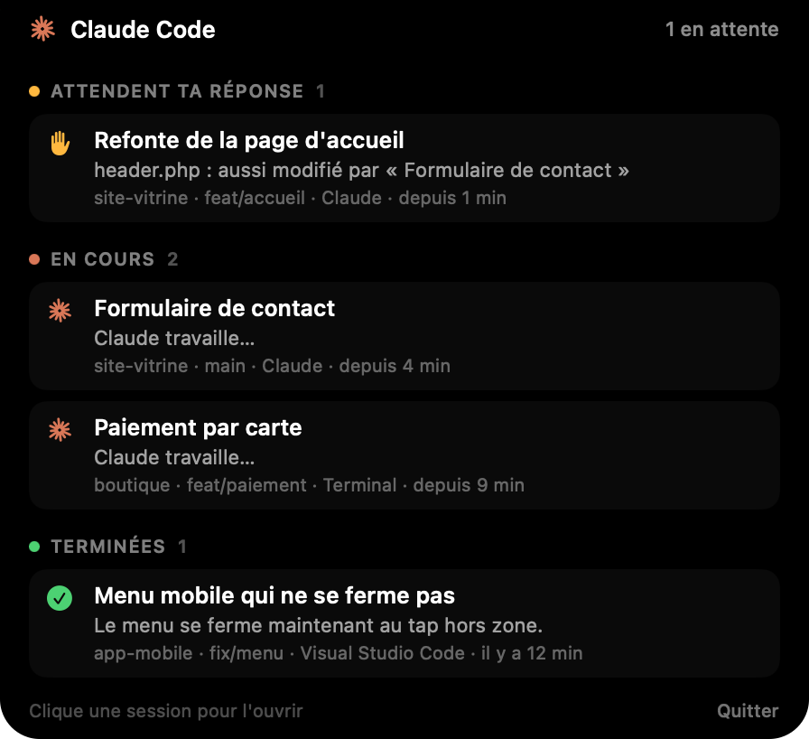
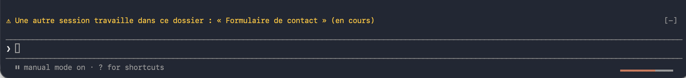

<p align="center">
  
</p>

<h1 align="center">notch-status</h1>

<p align="center">
  Tes sessions Claude Code dans l'encoche du Mac,<br>
  et un aiguilleur pour qu'elles ne se marchent pas dessus.
</p>

<p align="center">
  
</p>

Un mod pour [Claude Code](https://claude.com/claude-code), pensé pour qui fait tourner plusieurs sessions en parallèle.

## Ce qu'il fait

- **L'encoche.** Chaque session publie son état : en cours, attend ta réponse, terminée. L'app ClaudeNotch l'affiche dans l'encoche ; au survol, la liste détaillée ; un clic ramène la session au premier plan.
- **L'aiguilleur.** Avant qu'une session modifie un fichier qu'une autre vient de modifier, change de branche ou efface des changements (`switch`, `checkout`, `stash`, `reset --hard`, `clean -f`, `rebase`) dans un dossier partagé, ou écrive hors de son projet, il te demande ton accord, même en mode auto. Un bandeau nomme les autres sessions du même dossier.
- **L'usage de la semaine.** Une pilule discrète au pied de la saisie ; le pourcentage et le délai avant la remise à zéro s'affichent au survol.



## Installer

Dans une session Claude Code au terminal :

```
/plugin install notch-status --marketplace enzomerand/palan-plugins
```

Depuis un shell : `claude plugin install notch-status --marketplace enzomerand/palan-plugins`. Dans l'app de bureau : **+** à côté de la saisie, **Plugins**, **Add marketplace** avec `enzomerand/palan-plugins`, puis **Add plugin**.

Tape ensuite `/notch` une fois : le mod compile l'app de l'encoche et la lance.

**Prérequis** : un Mac à encoche (Apple Silicon, macOS 14 ou plus), les Xcode Command Line Tools (`xcode-select --install`) et Claude Code 2.1.317 ou plus récent.

## Bon à savoir

- L'aiguilleur ne voit que les sessions où le mod est chargé, et seulement les outils d'écriture (Edit, Write) : un `sed -i` lancé en Bash lui échappe.
- L'app lit aussi les fiches de session de l'app Claude, un format interne qui peut changer.
- Rien ne quitte ta machine : tout passe par des fichiers dans `~/.claude/notch/`.
- Le mod parle français.

## Licence

MIT, comme le reste de la [marketplace Palan](../..).
